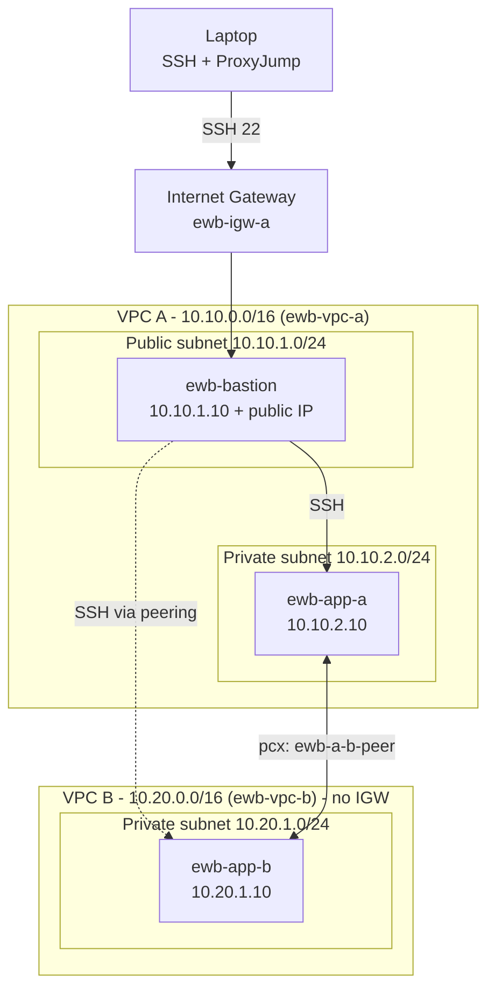

# AWS VPC Peering Project (EWB Courses – AWS Architect Associate)

Two private VPCs connected with **VPC Peering**, administered through a single public **bastion host** using SSH `ProxyJump`.
The whole lab is reproducible with AWS CLI scripts, and every test writes its real output into `evidence/`.

> **Author:** Ashwani Kumar Pandey  |  **Batch:** AWS INTERNSHIP  |  **Region:** eu-north-1 (Stockholm)  |  **Date:** 01-11-2026

## Architecture



## Address plan

| Resource | Parent | CIDR / IP |
|---|---|---|
| ewb-vpc-a | – | 10.10.0.0/16 |
| ewb-a-public | VPC A | 10.10.1.0/24 |
| ewb-a-private | VPC A | 10.10.2.0/24 |
| ewb-vpc-b | – | 10.20.0.0/16 |
| ewb-b-private | VPC B | 10.20.1.0/24 |
| ewb-bastion | ewb-a-public | 10.10.1.10 + public IPv4 |
| ewb-app-a | ewb-a-private | 10.10.2.10 (no public IP) |
| ewb-app-b | ewb-b-private | 10.20.1.10 (no public IP) |

## Route tables

| Route table | Destination | Target |
|---|---|---|
| ewb-rt-a-public | 10.10.0.0/16 · 0.0.0.0/0 · 10.20.0.0/16 | local · IGW · pcx |
| ewb-rt-a-private | 10.10.0.0/16 · 10.20.0.0/16 | local · pcx |
| ewb-rt-b-private | 10.20.0.0/16 · 10.10.0.0/16 | local · pcx |

## Security group inbound rules

| SG | Rule | Source |
|---|---|---|
| ewb-sg-bastion | SSH 22 | my public IP /32 |
| ewb-sg-app-a | SSH 22 | 10.10.1.10/32 (bastion) |
| ewb-sg-app-a | ICMP echo request | 10.20.1.10/32 (App-B) |
| ewb-sg-app-b | SSH 22 | 10.10.1.10/32 (bastion) |
| ewb-sg-app-b | ICMP echo request | 10.10.2.10/32 (App-A) |

## How to reproduce

Needs: AWS CLI v2 configured (`aws configure` or CloudShell), bash/WSL, OpenSSH.

```bash
git clone https://github.com/<your-username>/<repo-name>.git && cd <repo-name>
nano scripts/00-config.env            # set STUDENT_NAME
./scripts/01-deploy-base.sh           # VPCs, subnets, IGW, route tables, SGs, 3 EC2
./scripts/02-baseline-test.sh         # ping App-A -> App-B must FAIL (no peering yet)
./scripts/03-peering.sh               # request, accept, routes on both sides
./scripts/04-run-tests.sh             # forward ping, reverse ping, SSH to App-B, no public IP
./scripts/05-controlled-failure.sh    # remove ICMP rule -> fail, restore -> recover
./scripts/99-cleanup.sh               # delete everything (do this the same day!)
```

Each script saves its real output to `evidence/`.

## Results / evidence

All tests were executed on a real AWS account (eu-north-1) on 01-11-2026. The raw output of every test is in `evidence/`; the full write-up with screenshots is in `Ashwani_Kumar_Pandey_EWB_VPC_Peering.pdf`.

Measured results: baseline ping A->B before peering = 100% loss; after peering and routes A->B and B->A = 4/4 replies, 0% loss; SSH to App-B through the bastion worked; App-A/App-B had no public IPv4; removing the ICMP rule on `ewb-sg-app-b` gave 100% loss and restoring it recovered to 0% loss; cleanup verification returned no leftover resources.

| Test | Expected | Evidence |
|---|---|---|
| Baseline (before peering) | no replies | `evidence/02-baseline-before-peering.txt` |
| Forward ping A→B | 4 replies, 0% loss | `evidence/04-tests-after-peering.txt` |
| Reverse ping B→A | 4 replies, 0% loss | `evidence/04-tests-after-peering.txt` |
| SSH to App-B via bastion | shell on App-B | `evidence/04-tests-after-peering.txt` |
| Isolation | no public IPv4 on App-A/App-B | `evidence/04-tests-after-peering.txt` |
| Controlled failure + recovery | fail → recover | `evidence/05-controlled-failure-and-recovery.txt` |
| Cleanup | no leftover resources | `evidence/06-cleanup-verification.txt` |

## Key learnings

- VPC peering is **one-to-one and non-transitive**; the VPC CIDRs must not overlap.
- Peering alone is not enough: **both sides need routes**, and **security groups** must allow the traffic.
- Security groups are stateful, so reply traffic is allowed automatically.
- App-B sees the bastion's *private* IP as the SSH source when using ProxyJump.
- Peering does not give VPC B internet access through VPC A's internet gateway.

## Security notes

- No `.pem` keys, passwords or tokens are committed (see `.gitignore`).
- SSH and ICMP are never opened to `0.0.0.0/0`.
- App servers have no public IPs.
